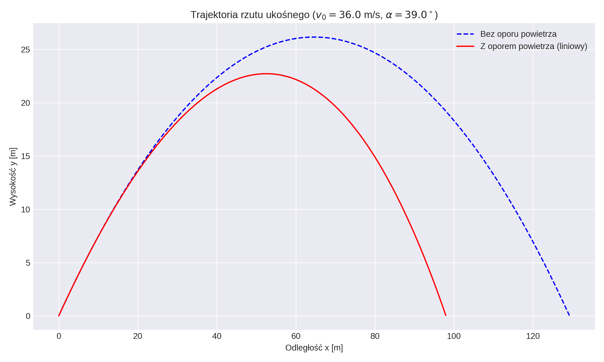
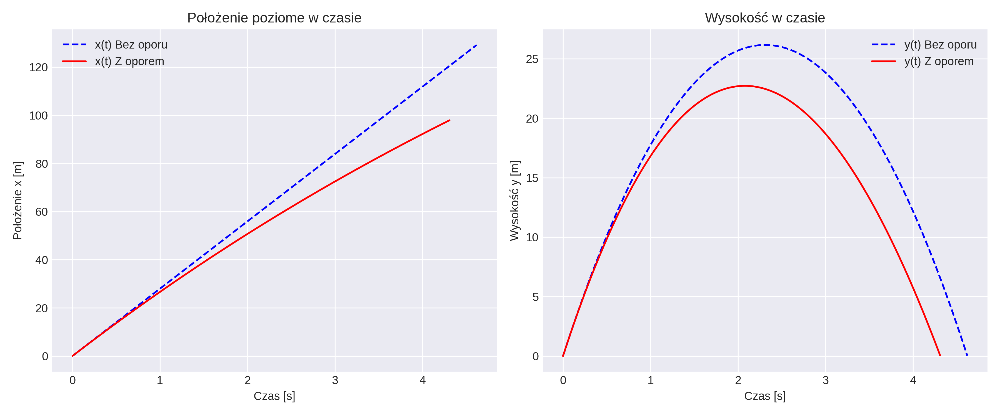
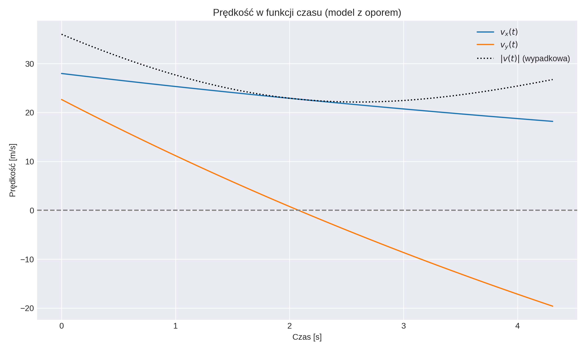

# Raport: Analiza rzutu ukośnego bez i z oporem powietrza

## 1. Wstęp i parametry początkowe

Celem niniejszego raportu jest analiza i porównanie kinematyki oraz dynamiki punktu materialnego poruszającego się w polu grawitacyjnym Ziemi (rzut ukośny) w dwóch przypadkach:
1. W próżni (bez oporu powietrza).
2. W ośrodku stawiającym opór (z uwzględnieniem oporu powietrza).

* **Prędkość początkowa ($v_0$):** $36 \text{ m/s}$ (dwie pierwsze cyfry)
* **Kąt początkowy ($\alpha$):** $39^\circ$ (dwie ostatnie cyfry)
* **Przyspieszenie ziemskie ($g$):** $9.81 \text{ m/s}^2$
* **Masa ciała ($m$):** $1.0 \text{ kg}$
* **Współczynnik oporu powietrza ($k$):** $0.1 \text{ kg/s}$ (dla modelu liniowego)

Wszystkie obliczenia przeprowadzono w układzie jednostek SI.

---

## 2. Model idealny (bez oporu powietrza)

W modelu idealnym jedyną siłą działającą na ciało w trakcie lotu jest siła ciężkości $\vec{Q} = [0, -mg]$. Zgodnie z drugą zasadą dynamiki Newtona ($m\vec{a} = \vec{F}$), możemy zapisać równania ruchu w układzie współrzędnych kartezjańskich (oś X – pozioma, oś Y – pionowa).

### 2.1 Wyprowadzenie równań ruchu

Rozkładając przyspieszenie na składowe:
$a_x = 0$
$a_y = -g$

Całkując przyspieszenie po czasie, otrzymujemy prędkość. Stałe całkowania wynikają z rozkładu wektora prędkości początkowej $v_0$ na składowe: $v_{0x} = v_0 \cos(\alpha)$ oraz $v_{0y} = v_0 \sin(\alpha)$.
$$v_x(t) = \int a_x \, dt = v_0 \cos(\alpha)$$
$$v_y(t) = \int a_y \, dt = v_0 \sin(\alpha) - gt$$

Kolejne całkowanie po czasie pozwala wyznaczyć równania toru (zakładamy położenie początkowe $x_0 = 0$, $y_0 = 0$):
$$x(t) = \int v_x(t) \, dt = v_0 \cos(\alpha) t$$
$$y(t) = \int v_y(t) \, dt = v_0 \sin(\alpha) t - \frac{1}{2}gt^2$$

### 2.2 Zasięg i maksymalna wysokość

Czas lotu $t_c$ wyznaczamy, przyrównując wysokość do zera ($y(t_c) = 0$ dla $t > 0$):
$$v_0 \sin(\alpha) t_c - \frac{1}{2}gt_c^2 = 0 \implies t_c = \frac{2v_0 \sin(\alpha)}{g}$$

Maksymalna wysokość ($H_{max}$) jest osiągana dla $t_h = \frac{t_c}{2}$:
$$H_{max} = y(t_h) = \frac{v_0^2 \sin^2(\alpha)}{2g}$$

Zasięg całkowity ($Z$):
$$Z = x(t_c) = \frac{v_0^2 \sin(2\alpha)}{g}$$

---

## 3. Model z oporem powietrza

Dla ciał poruszających się z niewielkimi prędkościami często przyjmuje się model siły oporu proporcjonalnej do prędkości (prawo Stokesa): $\vec{F}_o = -k\vec{v}$, gdzie $k$ to współczynnik oporu. 

### 3.1 Równania różniczkowe ruchu

Druga zasada dynamiki przyjmuje postać: $m\vec{a} = \vec{Q} + \vec{F}_o$.

Rozkładając to na osie:
$$m \frac{dv_x}{dt} = -k v_x$$
$$m \frac{dv_y}{dt} = -mg - k v_y$$

### 3.2 Rozwiązanie analityczne

Rozwiązując powyższe równania różniczkowe z uwzględnieniem warunków początkowych, otrzymujemy składowe prędkości:
$$v_x(t) = v_0 \cos(\alpha) \cdot e^{-\frac{k}{m}t}$$
$$v_y(t) = \left( v_0 \sin(\alpha) + \frac{mg}{k} \right) e^{-\frac{k}{m}t} - \frac{mg}{k}$$

Po scałkowaniu tych prędkości, otrzymujemy równania położenia:
$$x(t) = \frac{m \cdot v_0 \cos(\alpha)}{k} \left( 1 - e^{-\frac{k}{m}t} \right)$$
$$y(t) = \frac{m}{k} \left( v_0 \sin(\alpha) + \frac{mg}{k} \right) \left( 1 - e^{-\frac{k}{m}t} \right) - \frac{mg}{k}t$$

Ze względu na człon wykładniczy, zasięg rzutu z oporem powietrza jest zawsze mniejszy niż w modelu idealnym, a trajektoria staje się niesymetryczna (kąt upadku jest większy niż kąt rzutu).

---

## 4. Symulacja komputerowa (Python)

Poniższy kod rozwiązuje opisane zagadnienia i generuje wykresy, które zostaną osadzone w dalszej części raportu. **Zapisz poniższy kod jako plik `symulacja.py` w tym samym katalogu co ten plik Markdown i uruchom go.**

```python
import numpy as np
import matplotlib.pyplot as plt

# 1. Parametry początkowe
v0 = 36.0       # m/s
alpha_deg = 39.0 # stopnie
alpha = np.radians(alpha_deg)
g = 9.81        # m/s^2
m = 1.0         # kg
k = 0.1         # kg/s (współczynnik oporu)

# Składowe prędkości początkowej
v0x = v0 * np.cos(alpha)
v0y = v0 * np.sin(alpha)

# Czas całkowity lotu bez oporu (do określenia zakresu symulacji)
t_max_ideal = (2 * v0y) / g
t = np.linspace(0, t_max_ideal * 1.1, 1000)

# 2. Równania bez oporu powietrza
x_ideal = v0x * t
y_ideal = v0y * t - 0.5 * g * t**2

# Odrzucamy wartości poniżej gruntu
mask_ideal = y_ideal >= 0
x_ideal = x_ideal[mask_ideal]
y_ideal = y_ideal[mask_ideal]

# 3. Równania z oporem powietrza (model liniowy)
x_drag = (m * v0x / k) * (1 - np.exp(-(k/m)*t))
y_drag = (m / k) * (v0y + (m*g)/k) * (1 - np.exp(-(k/m)*t)) - ((m*g)/k)*t

# Odrzucamy wartości poniżej gruntu
mask_drag = y_drag >= 0
x_drag = x_drag[mask_drag]
y_drag = y_drag[mask_drag]
t_drag = t[mask_drag]

# Prędkości w modelu z oporem (dla wykresu prędkości)
vx_drag = v0x * np.exp(-(k/m)*t_drag)
vy_drag = (v0y + (m*g)/k) * np.exp(-(k/m)*t_drag) - (m*g)/k
v_tot_drag = np.sqrt(vx_drag**2 + vy_drag**2)

# 4. Generowanie wykresów
plt.style.use('seaborn-v0_8-darkgrid')

# Wyrkes 1: Trajektoria ruchu
plt.figure(figsize=(10, 6))
plt.plot(x_ideal, y_ideal, label='Bez oporu powietrza', linestyle='--', color='blue')
plt.plot(x_drag, y_drag, label='Z oporem powietrza (liniowy)', color='red')
plt.title(f'Trajektoria rzutu ukośnego ($v_0={v0}$ m/s, $\\alpha={alpha_deg}^\circ$)')
plt.xlabel('Odległość x [m]')
plt.ylabel('Wysokość y [m]')
plt.legend()
plt.tight_layout()
plt.savefig('wykres_trajektoria.png', dpi=300)
plt.close()

# Wykres 2: Współrzędne w czasie
plt.figure(figsize=(12, 5))
plt.subplot(1, 2, 1)
plt.plot(t[mask_ideal], x_ideal, '--', label='x(t) Bez oporu', color='blue')
plt.plot(t_drag, x_drag, label='x(t) Z oporem', color='red')
plt.title('Położenie poziome w czasie')
plt.xlabel('Czas [s]')
plt.ylabel('Położenie x [m]')
plt.legend()

plt.subplot(1, 2, 2)
plt.plot(t[mask_ideal], y_ideal, '--', label='y(t) Bez oporu', color='blue')
plt.plot(t_drag, y_drag, label='y(t) Z oporem', color='red')
plt.title('Wysokość w czasie')
plt.xlabel('Czas [s]')
plt.ylabel('Wysokość y [m]')
plt.legend()
plt.tight_layout()
plt.savefig('wykres_polozenie_czas.png', dpi=300)
plt.close()

# Wykres 3: Składowe prędkości w czasie (z oporem)
plt.figure(figsize=(10, 6))
plt.plot(t_drag, vx_drag, label='$v_x(t)$')
plt.plot(t_drag, vy_drag, label='$v_y(t)$')
plt.plot(t_drag, v_tot_drag, label='$|v(t)|$ (wypadkowa)', color='black', linestyle=':')
plt.axhline(0, color='gray', linestyle='--')
plt.title('Prędkość w funkcji czasu (model z oporem)')
plt.xlabel('Czas [s]')
plt.ylabel('Prędkość [m/s]')
plt.legend()
plt.tight_layout()
plt.savefig('wykres_predkosci.png', dpi=300)
plt.close()

print("Wygenerowano pomyślnie wykresy: wykres_trajektoria.png, wykres_polozenie_czas.png, wykres_predkosci.png")
```

---

## 5. Wyniki i Analiza Wykresów

Po uruchomieniu powyższego skryptu, zostaną wygenerowane i wyświetlone poniższe wykresy.

### 5.1 Trajektoria ruchu $y(x)$

Na poniższym wykresie zestawiono trajektorię idealną (parabola) z trajektorią uwzględniającą opór powietrza.



**Wnioski:** Jak widać, dla parametrów $v_0 = 36 \text{ m/s}$ i $\alpha = 39^\circ$ zasięg rzutu jest wyraźnie zredukowany przez opór powietrza. Ponadto krzywa z oporem traci asymetrię — zbocze opadania jest znacznie bardziej strome. Ciało nie dolatuje na odległość teoretyczną wynoszącą ok. $129 \text{ m}$, spadając znacznie bliżej punktu startowego w porównaniu do próżni.

### 5.2 Zależności położenia od czasu $x(t)$ oraz $y(t)$



**Wnioski:** 
* Wykres poziomy $x(t)$: Bez oporu powietrza prędkość pozioma jest stała (wykres liniowy). Z oporem powietrza prędkość pozioma maleje z czasem, co widać po zakrzywiającej się w dół funkcji na wykresie.
* Wykres pionowy $y(t)$: Z oporem ciało wolniej osiąga szczyt, a całkowity czas lotu $t_c$ jest krótszy niż w przypadku próżni.

### 5.3 Prędkości w modelu z oporem powietrza



**Wnioski:** 
* Prędkość $v_x$ asymptotycznie dąży do zera, stopniowo hamowana przez ośrodek.
* Prędkość $v_y$ w najwyższym punkcie toru przecina oś odciętych ($v_y = 0$). Następnie staje się ujemna, dążąc docelowo do stałej wartości zwanej **prędkością graniczną**, kiedy siła oporu zrównoważyłaby ciężar.
